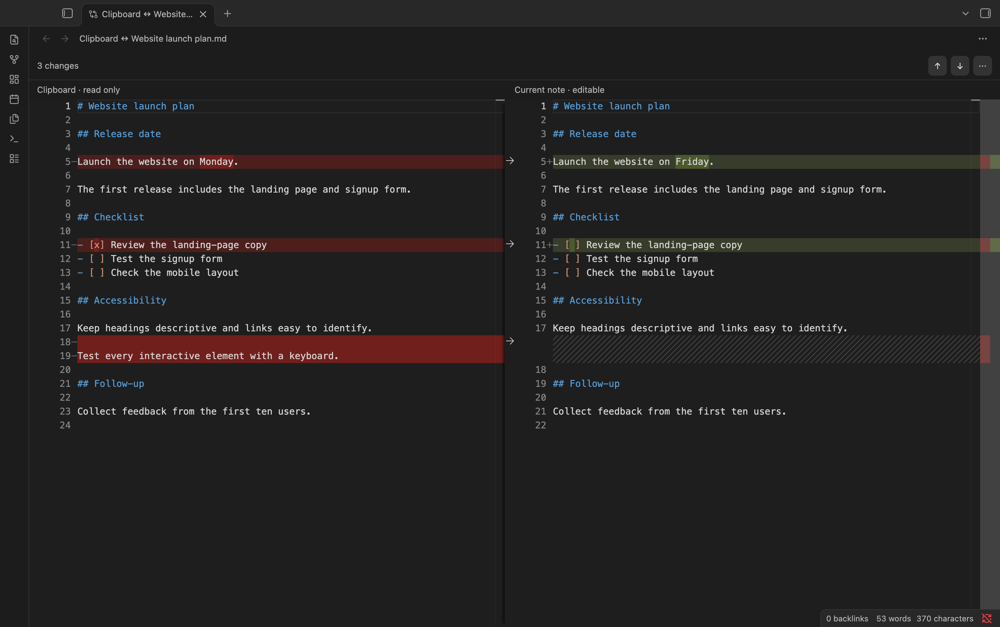

# Clipboard Compare

Compare text from your clipboard with the active note in Obsidian. It works like VS Code’s **Compare Active File with Clipboard** command.

## Use

1. Copy the text you want to compare.
2. Open your note and run **Clipboard Compare: Compare active file with clipboard** from the command palette.
3. Click an arrow to bring that change into your note. Leave it untouched to keep your original text.

Changes save automatically and can be undone.

## Install

1. Open [GitHub Releases](https://github.com/chaovven/obsidian-clipboard-compare/releases) and download `clipboard-compare.zip` under **Assets** in the latest release.
2. Unzip it and move the `clipboard-compare` folder into your vault’s `.obsidian/plugins/` folder.
3. Restart Obsidian and enable **Clipboard Compare** under **Settings → Community plugins**.

Works offline in Obsidian on desktop.

[MIT license](LICENSE).
